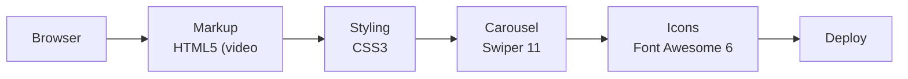

<h1 align="center">Star Rail — Game Landing Page</h1>

<p align="center"><b>A cinematic game landing page with a video hero, character carousel, soundtrack toggle and platform download CTAs.</b></p>

<p align="center">
<a href="https://mister2314.github.io/Hsr-template/"></a>


</p>

<p align="center"><a href="https://mister2314.github.io/Hsr-template/"><b>Live demo</b></a> &nbsp;·&nbsp; <a href="#quick-start">Quick start</a> &nbsp;·&nbsp; <a href="#features">Features</a> &nbsp;·&nbsp; <a href="#architecture">Architecture</a> &nbsp;·&nbsp; <a href="#faq">FAQ</a></p>

<p align="center">
  <a href="https://mister2314.github.io/Hsr-template/">
    
  </a>
</p>

<p align="center"><sub>Live capture of the real build — 2575 KB, loops forever.</sub></p>

## Overview

A landing page for a space-fantasy game, built around motion and atmosphere. A muted video fills the hero, characters rotate through a Swiper carousel, and a small audio control lets the visitor toggle the soundtrack on and off without leaving the page.

The build leans on layered backgrounds, gradient overlays and blur to keep text readable over moving footage — the part of this kind of page that is easy to get wrong.

## At a glance

| Field | Detail |
| --- | --- |
| **Type** | Static site — no build step |
| **Primary language** | CSS |
| **Live demo** | [mister2314.github.io/Hsr-template](https://mister2314.github.io/Hsr-template/) |
| **Repository** | [Mister2314/Hsr-template](https://github.com/Mister2314/Hsr-template) |

## Features

- Full-screen autoplaying video hero with audio toggle
- Character carousel powered by Swiper
- Soundtrack playback control with on / off states
- Layered gradient and blur overlays for text legibility
- Platform download buttons — Windows, PlayStation 5, App Store, Google Play
- QR code block for mobile download
- Font Awesome icon set

## Tech Stack

| Layer | Technology |
| --- | --- |
| Markup | HTML5 (video, audio) |
| Styling | CSS3 |
| Carousel | Swiper 11 |
| Icons | Font Awesome 6 |
| Deploy | GitHub Pages |

## Architecture



## Screenshots

| Desktop | Mobile |
| :---: | :---: |
|  |  |

## Quick Start

```bash
git clone https://github.com/Mister2314/Hsr-template.git
cd Hsr-template

# open it directly
start index.html      # Windows
open  index.html      # macOS

# or serve the folder
npx serve .
```

## Project Structure

```
index.html — hero, character carousel and download sections
assets/css/style.css — layout, overlays and carousel styling
assets/js/index.js — Swiper init, audio toggle, video handling
assets/video/, assets/music/, assets/img/ — media assets
```

## FAQ

<details>
<summary><b>Where does the background video come from?</b></summary>

A local `.mp4` in `assets/video/`. It is muted and autoplaying, which is the only way a browser will let it start without a user gesture.

</details>

<details>
<summary><b>How is the text readable over moving footage?</b></summary>

Layered gradient and blur overlays sit between the video and the copy. Without them the headline disappears whenever the footage goes bright.

</details>

<details>
<summary><b>How does the soundtrack toggle work?</b></summary>

An `<audio>` element with on/off state, driven by one click handler. It starts muted and only plays after an explicit click — browsers block autoplaying audio.

</details>

## Roadmap

- [ ] Replace the video with a compressed WebM
- [ ] Pause the video when the tab is hidden
- [ ] Add a poster frame for slow connections

## Author

**Xəyal Hüseynli** — Junior Front-End Developer

[Portfolio](https://hypnosdev.vercel.app) · [GitHub](https://github.com/Mister2314) · [LinkedIn](https://www.linkedin.com/in/x%C9%99yal-h%C3%BCseynli-3487b91ba/) · [xeyalhuseynli06@gmail.com](mailto:xeyalhuseynli06@gmail.com)
