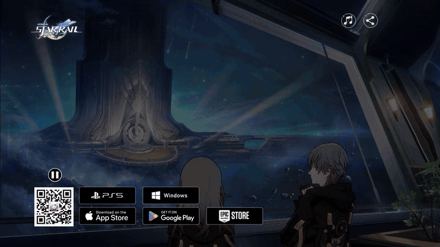
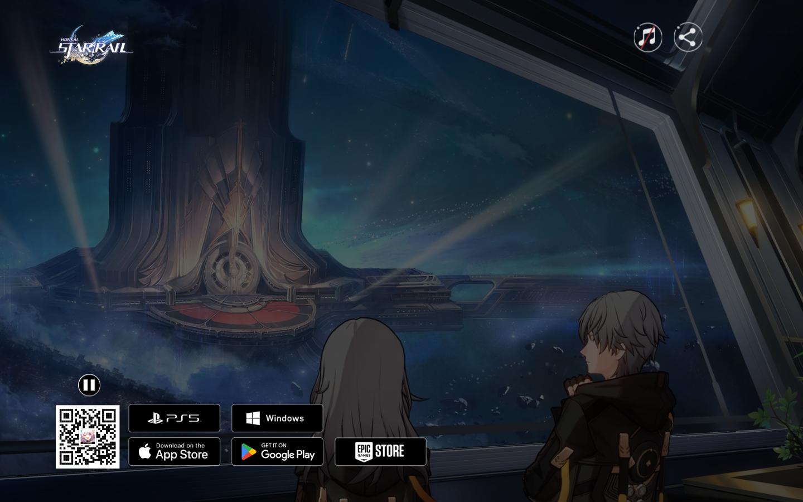
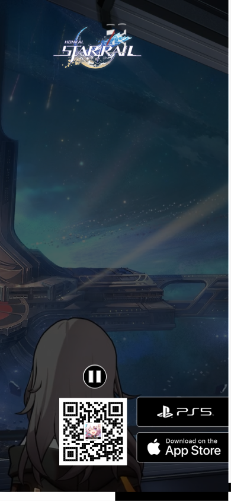
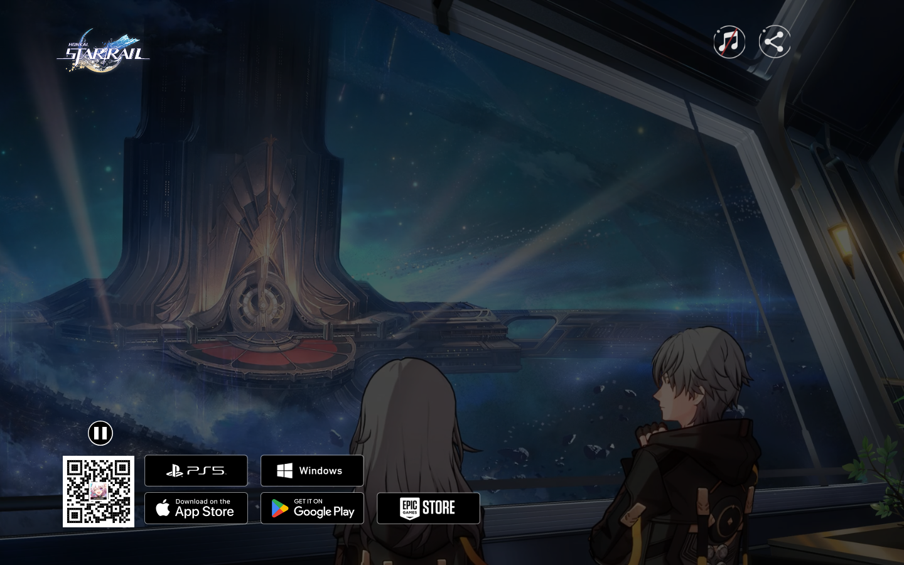
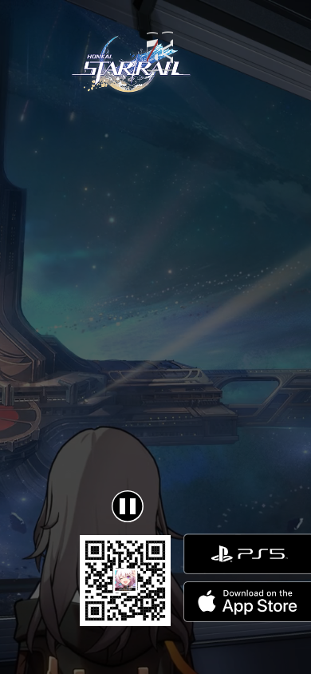

# Hsr-template

Game landing page for Honkai: Star Rail — video hero, interactive character dossiers, soundtrack toggle and platform download links.

**Live demo:** <https://hsr-template.vercel.app/>

<div align="center">



| Desktop | Mobile |
|---|---|
|  |  |

<details>
<summary>More screenshots</summary>

| Desktop | Mobile |
|---|---|
|  |  |

</details>

</div>

## What it does

Reproduces a AAA-game storefront hero: a muted MP4 fills the screen, platform CTAs (Windows, PS5, Epic, App Store, Google Play) sit over it, and an interactive character dossier section lets you open each trailblazer's file. React wires the video play/pause and an `<audio>` soundtrack toggle whose state is remembered in `localStorage`.

## Tech stack

React 19 · TypeScript · Vite — zero animation libraries (72 KB gzip JS total)

## Features

- **Poster-first video hero** — a 160 KB poster frame renders instantly; the 12.6 MB MP4 only autoplays on desktop-class viewports. On mobile the hero is a composed still (a 390 px phone should not download a trailer by default)
- **Intersection-aware playback** — an IntersectionObserver pauses the video when the hero scrolls offscreen and resumes it when you come back (only if you had it playing)
- **Stable character stage** — "Board the Astral Express" is a fixed-aspect stage that exists from first paint: selecting a character only changes what is inside it, so nothing on the page ever shifts or jumps. The stage portrait uses a transparent-background cutout (classical flood-fill keying, no AI) with a per-character focal point so every face is framed correctly
- **Interactive character dossier** — five characters (Kafka, Blade, Dan Heng, Black Swan, Argenti) with element/path badges; the selected character cross-fades onto the stage (transform/opacity only)
- **Keyboard-first roster** — the roster is a listbox with roving tabindex: arrow keys move between characters, Home/End jump, focus follows selection and the stage updates live; the soundtrack, share and theme controls are real buttons with `aria-pressed` / `aria-label`
- **Dark & light themes** — system default with a persisted toggle and no first-paint flash (`color-scheme` set before render); the light theme is a designed warm "starlight paper", not an inverted dark
- **Soundtrack toggle** that persists its muted/unmuted state in `localStorage`
- **Platform CTA polish** — semantic anchors with alt text, focus-visible rings, hover lift and press-scale, laid out responsively instead of at hardcoded pixel positions
- **Reduced motion honored** — `prefers-reduced-motion` disables all transitions, skips autoplay and view transitions; the static page is the complete page

## Fan content

Unofficial, non-commercial fan project — not affiliated with or endorsed by HoYoverse/Cognosphere. Imagery is game art processed for presentation only (crops, cut-outs) under the [Honkai: Star Rail Fan Creations Guide](https://hsr.hoyoverse.com/en-us/news/111203); all rights belong to their owners. No official site code or assets are hotlinked; everything is served from this repository.

## Run locally

```bash
git clone https://github.com/Mister2314/Hsr-template.git
cd Hsr-template
npm install
npm run dev
```

## What I learned

- Browsers only let autoplaying video start muted, and only let audio start after a click — so the soundtrack begins silent and unlocks on the first toggle.
- `preload="metadata"` + a poster attribute is the cheapest big win a video hero can get: first paint drops from megabytes to one JPEG, and the browser only streams the video when you decide it should play.
- The View Transitions API makes shared-element morphs a one-liner — `document.startViewTransition(update)` — but you must move the `view-transition-name` off the card the moment the panel opens, or the duplicate name silently cancels the animation.
